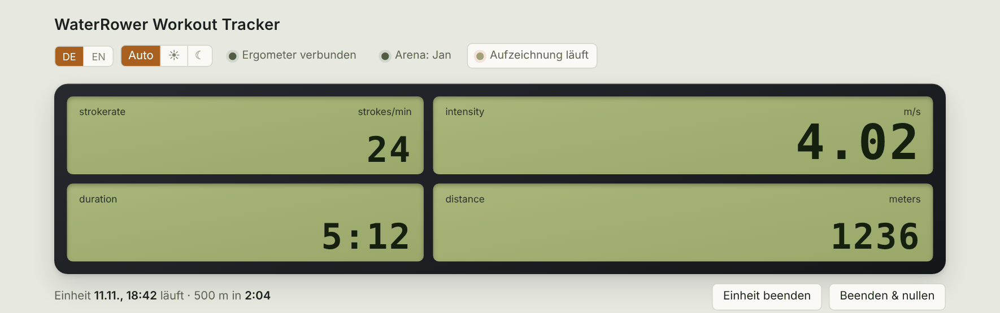

# WaterRower ESP

[🇩🇪 Deutsch](README.md) · 🇬🇧 English

Firmware for an **ESP32-S3** that sits between the WaterRower S4 and your Wi-Fi: it reads the rowing machine over USB, records every workout to its own flash and serves the web UI itself. No server, no container, no cloud account.



```
WaterRower S4 ──USB──► ESP32-S3 ──Wi-Fi──► browser (phone/PC)  http://waterrower.local
                        │  recording (flash), charts, CSV/Excel
                        ├── MQTT / Home Assistant (optional)
                        └── arena uplink (optional)
```

> The screenshots come from a mock server with **generated sample data**, not from a real workout. The UI is shown in German; it can be switched to English with the DE/EN toggle.

## Features

- **Live view** with distance, pace, split/500 m, stroke rate, watts and a history chart
- **Recording to internal flash** (~10 MB, oldest workouts are deleted when space runs out), recovery after power loss
- **History and comparison** of workouts, export as **CSV** and **Excel** (generated in the browser)
- **Wi-Fi setup without reflashing:** without credentials the ESP opens a hotspot with a setup page
- Light/dark theme, German/English, phone-friendly
- Firmware update from the web UI (OTA)
- **Optional:** MQTT with Home Assistant discovery, arena uplink for rowing together

## Quick start

1. Flash the prebuilt image from [`firmware/release/`](firmware/release/) to address `0x0` (browser flasher or `esptool`).
2. Connect to the hotspot `WaterRower-XXXX` (password `waterrower`) and pick your Wi-Fi.
3. Open `http://waterrower.local`.

Details in [Setup](docs_en/einrichtung.md).

## Documentation

| Topic | File |
|---|---|
| Hardware, flashing, Wi-Fi, moving house | [docs_en/einrichtung.md](docs_en/einrichtung.md) |
| Using the web UI | [docs_en/bedienung.md](docs_en/bedienung.md) |
| MQTT and Home Assistant | [docs_en/mqtt-home-assistant.md](docs_en/mqtt-home-assistant.md) |
| Arena (multiplayer) | [docs_en/arena.md](docs_en/arena.md) |
| Security | [docs_en/sicherheit.md](docs_en/sicherheit.md) |
| Building, tests, code layout | [docs_en/entwicklung.md](docs_en/entwicklung.md) |
| Printable case | [case/](case/) |

## Status and limits

- The firmware **compiles** (ESP-IDF 6.1 via PlatformIO) and the storage logic is tested on a PC. **Not yet tested on real hardware:** the S4 USB link, captive portal, TLS to the arena and OTA should be verified one by one first.
- MQTT discovery is checked for valid JSON, but not against a real broker or Home Assistant.
- The Excel export contains tables but no chart.
- At most 4 simultaneous live views.

The arena server lives in its own repository: [MojoOne1/waterrower-arena](https://github.com/MojoOne1/waterrower-arena).
