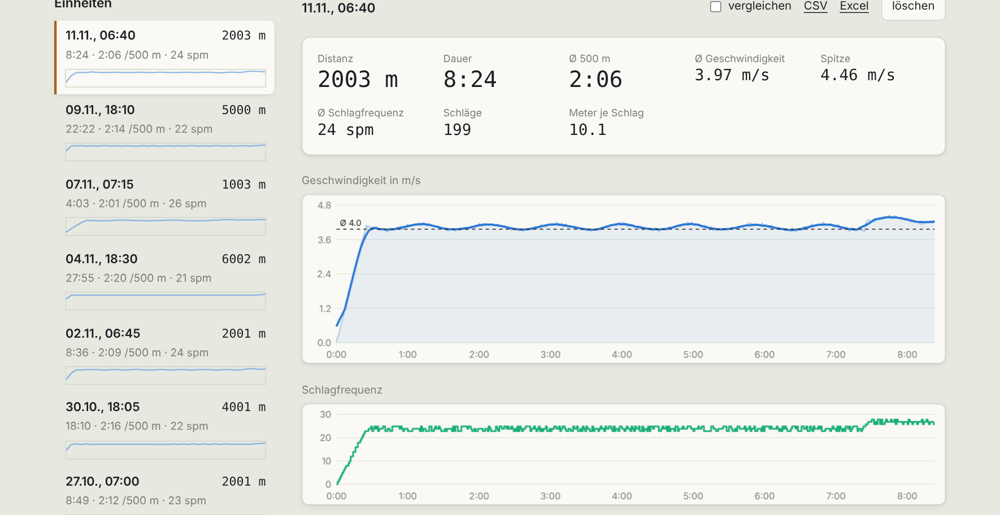
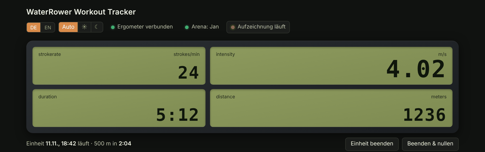
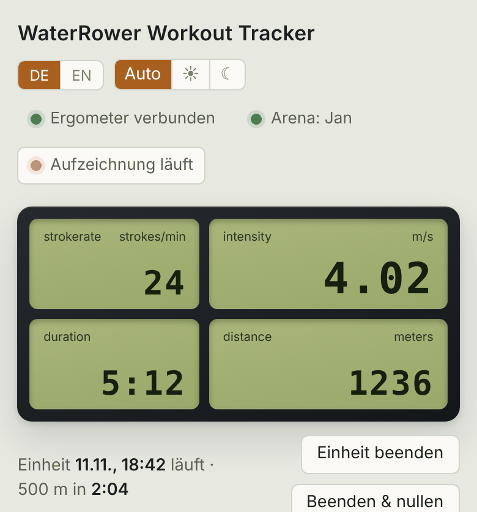
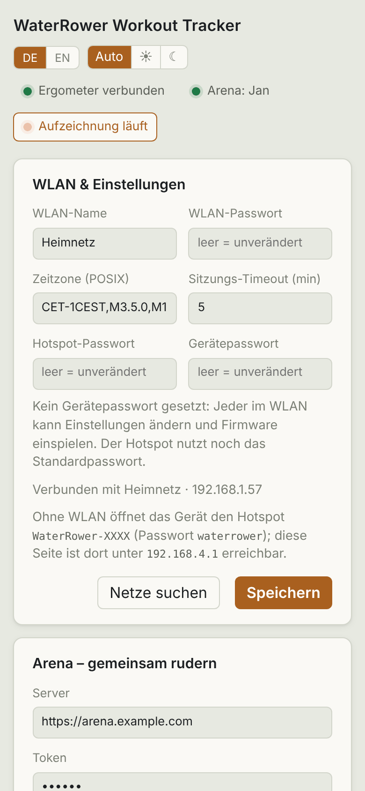

# Bedienung

## Live

Während des Ruderns zeigt die Seite Distanz, Tempo, Split pro 500 m, Schlagfrequenz, Watt und Dauer, dazu ein Verlaufsdiagramm. Die Werte kommen per Server-Sent-Events vom ESP (einmal pro Sekunde). Eine Einheit beginnt mit dem ersten Zug und endet nach dem eingestellten Timeout oder über *Sitzung beenden*. *Zurücksetzen* verwirft die laufende Einheit.

Die Chips oben zeigen, ob die S4 verbunden ist, ob aufgezeichnet wird und ob die Arena verbunden ist.

## Verlauf und Vergleich

Jede Einheit erscheint mit Datum, Distanz, Dauer, Durchschnittstempo und Mini-Verlauf. Ein Klick öffnet die Einheit mit Diagrammen. Mit *Vergleichen* lassen sich mehrere Einheiten übereinanderlegen.

## Export

- **CSV** je Einheit
- **Excel** je Einheit oder für alle, im Browser erzeugt (ohne Diagramm)

## Handy und Dunkelmodus

Umschalter oben für Sprache (DE/EN) und Darstellung (Auto, hell, dunkel).

## Speicher

Einheiten liegen im internen Flash (~10 MB). Wird es eng, werden die ältesten gelöscht. Nach einem Stromausfall wird die laufende Einheit beim nächsten Start wiederhergestellt.

> Alle Screenshots zeigen erzeugte Beispieldaten.
