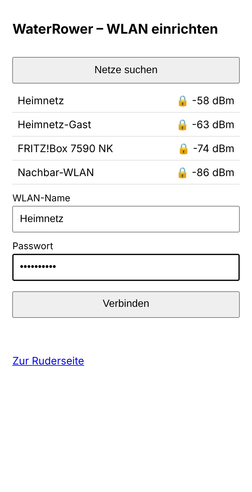
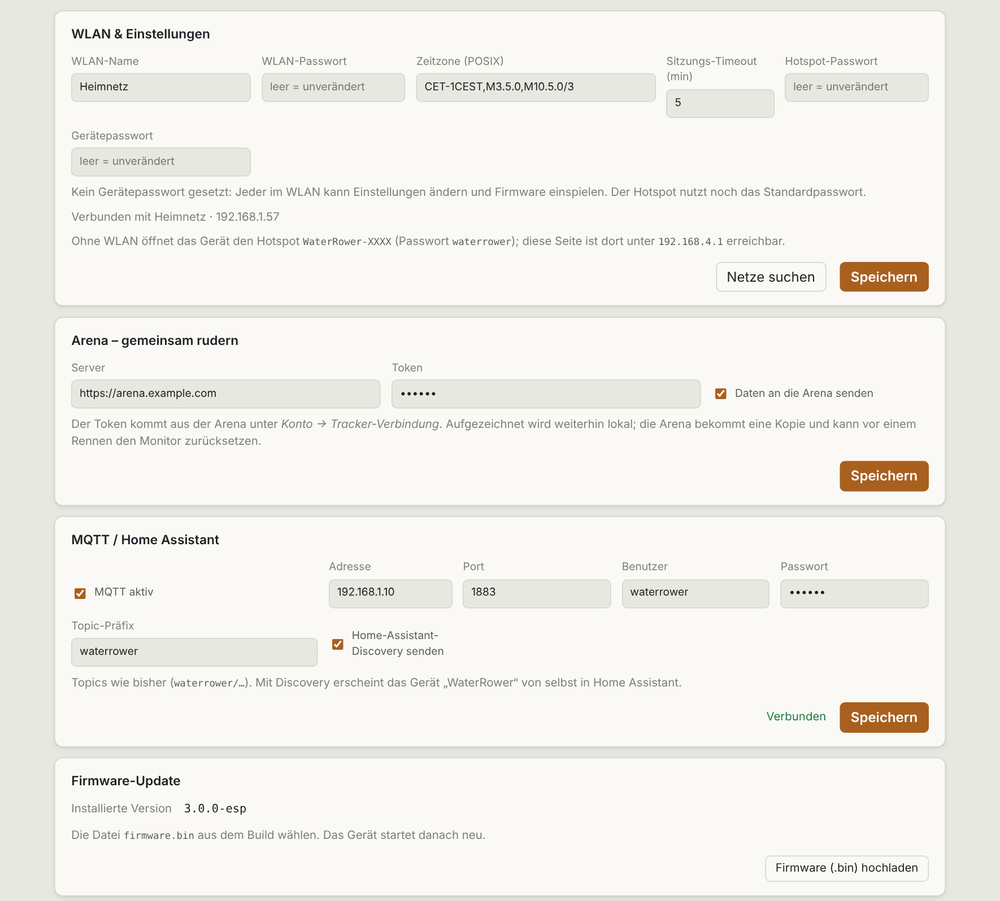

# Einrichtung

🇩🇪 Deutsch · [🇬🇧 English](en/einrichtung.md)

## Hardware

- ESP32-S3-DevKitC-1 (N16R8: 16 MB Flash, 8 MB PSRAM)
- USB-OTG-Lötbrücke auf dem Board geschlossen
- Port **COM** zum PC (Flashen, Log), Port **USB** über Adapter zur WaterRower S4 (Host-Betrieb)
- Gehäuse: [case/](../case/)

## Flashen

### Fertiges Image

[`firmware/release/waterrower-esp-3.0.0-merged.bin`](../firmware/release/) enthält Bootloader, Partitionstabelle, OTA-Daten und App und gehört an **Adresse 0x0**:

- Browser (Chrome/Edge): <https://espressif.github.io/esptool-js/>, Offset `0x0`
- Kommandozeile: `esptool --chip esp32s3 write_flash 0x0 waterrower-esp-3.0.0-merged.bin`

Prüfsumme in `SHA256SUMS`. Das Image ist ein Build aus dem jeweiligen Commit, kein signiertes Release.

### Selbst bauen

```bash
pip install platformio
cd firmware
pio run                 # baut .pio/build/esp32s3/firmware.bin
pio run -t upload       # erstes Flashen über COM (ggf. BOOT gedrückt halten)
pio device monitor      # Log
```

Spätere Updates laufen über die Weboberfläche (Karte *Firmware-Update*, Datei `firmware.bin`).

## WLAN einrichten

Ohne gespeicherte Zugangsdaten, oder wenn das Netz nicht erreichbar ist, öffnet der ESP nach ca. 20 s den Hotspot **`WaterRower-XXXX`** (Passwort `waterrower`).



1. Handy mit dem Hotspot verbinden. Die Einrichtungsseite öffnet sich selbst, sonst `http://192.168.4.1/setup`.
2. Netz wählen, Passwort eingeben, speichern.
3. Der ESP verbindet sich und ist danach unter `http://waterrower.local` (oder seiner IP) erreichbar.

Auch ohne WLAN lässt sich rudern: Die Seite ist am Hotspot unter `192.168.4.1` erreichbar, die Uhrzeit kommt dann vom Browser.

## Einstellungen



| Feld | Bedeutung |
|---|---|
| WLAN-Name / -Passwort | Heimnetz; leeres Passwort lässt das gespeicherte unverändert |
| Zeitzone | POSIX-String, Standard `CET-1CEST,M3.5.0,M10.5.0/3` |
| Sitzungs-Timeout | Minuten ohne Zug, bis eine Einheit automatisch endet (1–60) |
| Hotspot-Passwort | ersetzt `waterrower`, siehe [Sicherheit](sicherheit.md) |
| Gerätepasswort | schützt ändernde Zugriffe, siehe [Sicherheit](sicherheit.md) |

## Umzug

Neues WLAN: ESP einstecken. Findet er das alte Netz nicht, öffnet er nach ca. 20 s den Hotspot, dort das neue WLAN eintragen.

## Uhrzeit

NTP, sobald Internet da ist. Sonst übernimmt der ESP die Uhrzeit vom Browser, der die Seite öffnet.
