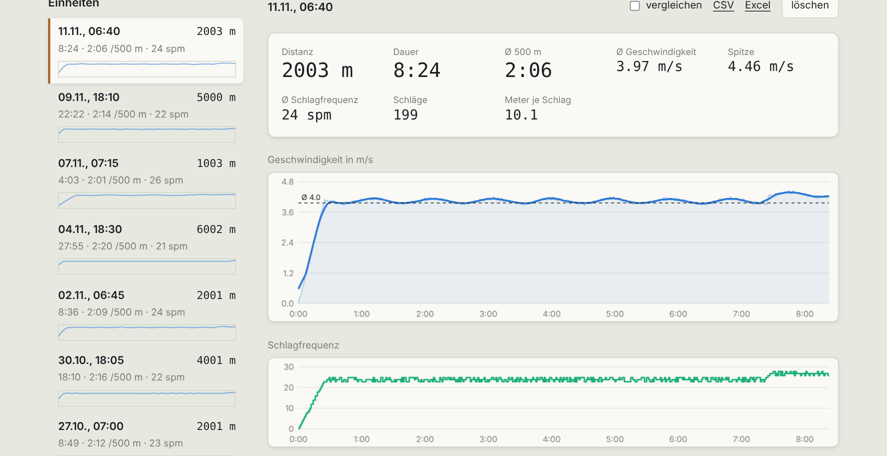
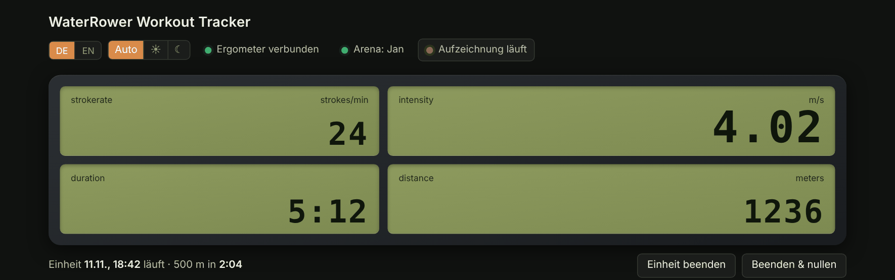
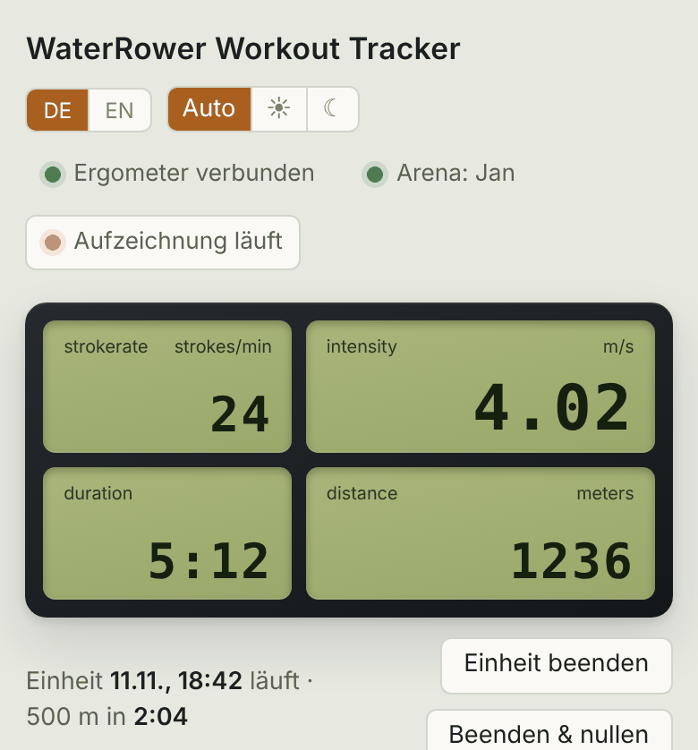
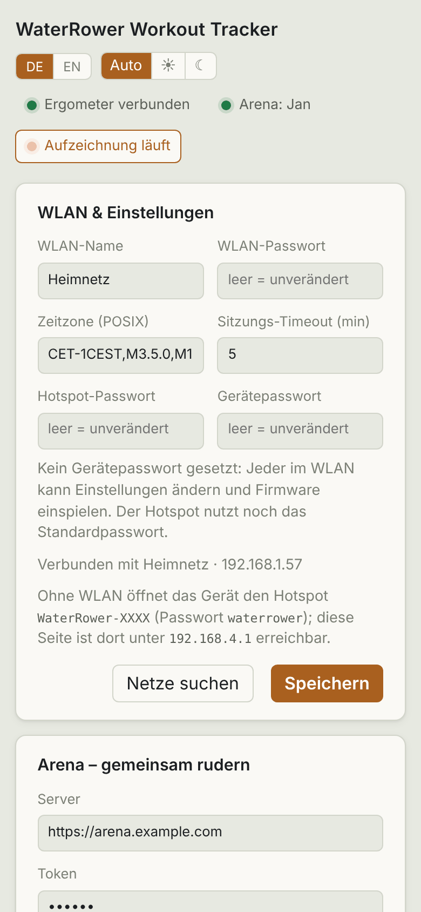

# Bedienung

🇩🇪 Deutsch · [🇬🇧 English](../docs_en/bedienung.md)

Die Seite öffnest du im Browser unter `http://waterrower.local` (Handy oder PC im selben WLAN, siehe [Einrichtung](einrichtung.md#seite-öffnen)).

## Live

Vier Kacheln wie am Monitor: **Schlagfrequenz** (Schläge/min), **Geschwindigkeit** (m/s), **Dauer** und **Distanz** (m). Darunter die laufende Einheit mit der Zeit für 500 m. Bis zum ersten Zug steht dort „Warten auf Ruderschlag“.

Die Chips oben: **Ergometer verbunden** (S4 am ESP erkannt), **Aufzeichnung läuft** und **Arena: Name** (falls die [Arena](arena.md) verbunden ist). Die Werte kommen einmal pro Sekunde direkt vom ESP.

Eine Einheit beginnt mit dem ersten Zug und endet nach dem eingestellten Timeout (Standard 5 Minuten ohne Zug) oder per Knopf:

- **Einheit beenden:** schließt die Einheit ab, der Monitor behält seine Anzeige.
- **Beenden & nullen:** schließt ab und setzt den Monitor auf null.

## Einheiten und Verlauf

Links die Liste aller Einheiten: Datum, Distanz, Dauer, Zeit pro 500 m, Schlagfrequenz und ein kleiner Geschwindigkeitsverlauf. Ein Klick öffnet die Einheit rechts mit Kennzahlen (Distanz, Dauer, Ø 500 m, Ø Geschwindigkeit, Spitze, Ø Schlagfrequenz, Schläge, Meter je Schlag) und zwei Diagrammen: Geschwindigkeit und Schlagfrequenz über die Zeit.

**Vergleichen:** Hakt man *vergleichen* bei bis zu vier Einheiten an, erscheint unten ein Diagramm, das ihre Geschwindigkeit ab Start übereinanderlegt. *Alle Einheiten* zeigt die Distanz je Einheit im Zeitverlauf.

## Export und Löschen

- **CSV** und **Excel** je Einheit (Links über der Einheit), **Alle als Excel** für alle Einheiten. Excel wird im Browser erzeugt und enthält Tabellen, kein Diagramm.
- **löschen** entfernt eine Einheit endgültig (mit Rückfrage).

## Handy und Dunkelmodus

Oben links wechselt man Sprache (DE/EN) und Darstellung (Auto, hell, dunkel). Die Seite ist für Handys ausgelegt.

## Speicher

Einheiten liegen im internen Flash des ESP (ca. 10 MB). Wird es eng, werden die ältesten gelöscht. Nach einem Stromausfall wird die laufende Einheit beim nächsten Start wiederhergestellt. Wer Einheiten dauerhaft sichern will, exportiert sie als CSV oder Excel.

> Alle Screenshots zeigen erzeugte Beispieldaten.
