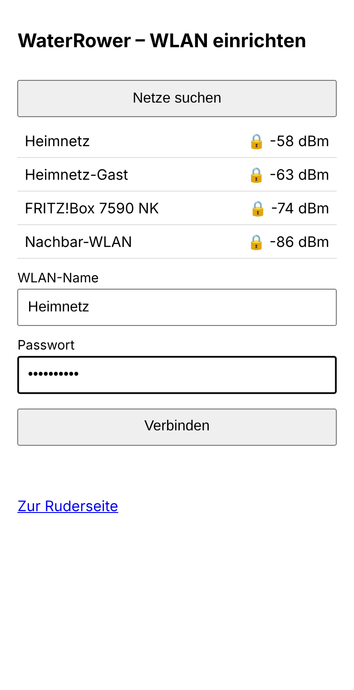
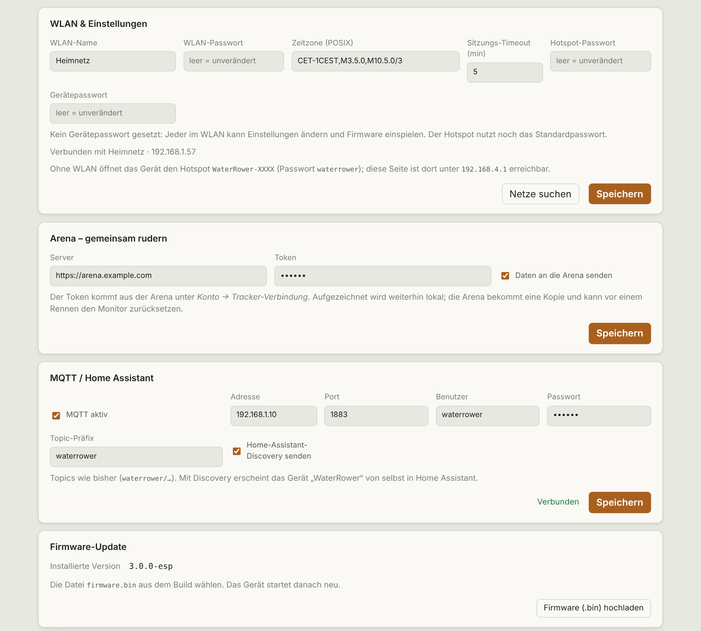

# Einrichtung

🇩🇪 Deutsch · [🇬🇧 English](../docs_en/setup.md)

Von der leeren Platine bis zur ersten Einheit. Vorkenntnisse sind nicht nötig.

## Überblick

1. [Hardware besorgen und verbinden](#hardware)
2. [Firmware flashen](flashen.md) (einmalig, am Computer)
3. [WLAN einrichten](#wlan-einrichten) (am Handy)
4. [Seite öffnen und rudern](#seite-öffnen)

## Hardware

| Teil | Hinweis |
|---|---|
| ESP32-S3-DevKitC-1 (N16R8) | 16 MB Flash, 8 MB PSRAM (andere Speichervarianten reichen nicht). Zwei USB-C-Buchsen: **COM** (UART, Flashen und Strom) und **USB** (nativer OTG-Port). Verwendet: [ESP32-S3-WROOM-1 N16R8 DevKitC-1 (amazon.de)](https://www.amazon.de/dp/B0FYFF8CB2/); jeder DevKitC-1-Klon mit zwei USB-C-Buchsen und USB-OTG-Lötbrücke sollte gehen |
| WaterRower S4 Performance Monitor | batteriebetrieben, Mini-USB-Buchse |
| USB-C-auf-Mini-USB-Adapter | zwischen USB-C-Kabel und der Mini-USB-Buchse der S4. Verwendet: [4x USB-C-Buchse auf Mini-USB-Stecker (amazon.de)](https://www.amazon.de/dp/B0G4BYT22N); er ersetzt das Kabel der S4 |
| USB-C-Kabel | vom **USB**-Port des ESP zu diesem Adapter |
| USB-Netzteil (5 V) | am **COM**-Port, für den Dauerbetrieb |
| USB-C-**Datenkabel** | zum Flashen am Computer (ein reines Ladekabel genügt nicht) |

Optional ein [Gehäuse zum Drucken](../case/) für die Rückseite der S4, auf Wunsch mit QR-Code zu diesem Repository im Deckel (`esp32case_lid_qr.stl`).

### Die USB-OTG-Lötbrücke

Auf der Unterseite des DevKitC-1-Klons gibt es eine Lötbrücke mit der Aufschrift **USB-OTG**. Sie ist ab Werk **offen** und muss **geschlossen** werden. Sie verbindet die VBUS-Leitungen beider USB-C-Buchsen: Nur dann liefert der **USB**-Port die 5 V, an denen die S4 überhaupt erkennt, dass ein Host dranhängt. Die S4 zieht darüber praktisch keinen Strom, sie läuft aus ihren eigenen Batterien.

**Wichtig:** Ist die Brücke geschlossen, nie beide Buchsen gleichzeitig an getrennte Stromquellen hängen (zum Flashen am Computer also kein Netzteil am **USB**-Port).

### Verkabelung

```
USB-Netzteil ──► [COM]  ESP32-S3  [USB] ──USB-C──► C-auf-Mini-Adapter ──► S4
                                     ▲
                         (USB-OTG-Lötbrücke geschlossen)
```

Ein USB-C-auf-USB-A-Adapter plus das Originalkabel der S4 geht genauso; der Mini-USB-Adapter spart nur ein Glied.

## Flashen

Ausführlich mit Bildern der Schritte und Fehlerhilfe: **[Flashen mit dem Browser-Flasher](flashen.md)**. Kurz: [`firmware/release/waterrower-esp-3.0.0-merged.bin`](../firmware/release/) an Adresse **`0x0`** schreiben.

Wer selbst bauen will: [Entwicklung](entwicklung.md).

## WLAN einrichten

Ohne gespeicherte Zugangsdaten öffnet der ESP sofort den Hotspot **`WaterRower-XXXX`** (Passwort `waterrower`). Kennt er ein Netz, das nicht erreichbar ist, geschieht das nach ca. 20 Sekunden.



1. Am Handy in den WLAN-Einstellungen **`WaterRower-XXXX`** wählen, Passwort `waterrower`. Das Handy meldet „kein Internet“: **verbunden bleiben**. Ggf. „Mobile Daten“ kurz ausschalten, sonst wechselt das Handy zurück.
2. Die Einrichtungsseite öffnet sich von selbst. Sonst im Browser `http://192.168.4.1/setup` eingeben.
3. **Netze suchen**, das eigene Netz antippen, Passwort eingeben, **Verbinden**.
4. Der ESP startet die Verbindung, der Hotspot verschwindet. Das Handy wieder mit dem Heim-WLAN verbinden.

## Seite öffnen

Im Heim-WLAN im Browser **`http://waterrower.local`** eingeben (`http://`, nicht `https://`).

Öffnet sich nichts (manche Android-Geräte kennen `.local` nicht): in der Geräteliste des Routers nach **„waterrower“** suchen und dessen IP-Adresse eingeben, z. B. `http://192.168.1.57`. Ein anderer Name wie `waterrower.fritz.box` wird aus Sicherheitsgründen abgelehnt, dann die IP nehmen.

Ohne WLAN geht es auch: Mit dem Hotspot verbinden und `http://192.168.4.1` öffnen.

Der Chip oben zeigt **„Ergometer verbunden“**, sobald die S4 am ESP hängt. Mit dem ersten Zug beginnt eine Einheit. Alles Weitere: [Bedienung](bedienung.md).

## Einstellungen



Karte **WLAN & Einstellungen** (weiter unten auf der Seite):

| Feld | Bedeutung |
|---|---|
| WLAN-Name / -Passwort | Heimnetz; leeres Passwortfeld lässt das gespeicherte unverändert. *Netze suchen* listet Netze in Reichweite. |
| Zeitzone | POSIX-String, Standard `CET-1CEST,M3.5.0,M10.5.0/3` (Mitteleuropa mit Sommerzeit) |
| Sitzungs-Timeout | Minuten ohne Zug, bis eine Einheit automatisch endet (1–60, Standard 5) |
| Hotspot-Passwort | ersetzt `waterrower` (mind. 8 Zeichen), siehe [Sicherheit](sicherheit.md) |
| Gerätepasswort | schützt Änderungen, siehe [Sicherheit](sicherheit.md) |

Darunter: Karten für [Arena](arena.md), [MQTT / Home Assistant](mqtt-home-assistant.md) und *Firmware-Update*.

## Umzug oder neues WLAN

ESP einstecken. Findet er das alte Netz nicht, öffnet er nach ca. 20 s den Hotspot; dort das neue WLAN eintragen.

## Uhrzeit

Per NTP, sobald Internet da ist. Sonst übernimmt der ESP die Uhrzeit vom Browser, der die Seite öffnet.

## Hilfe

| Problem | Lösung |
|---|---|
| Hotspot erscheint nicht | 30 s warten, ESP aus- und einstecken. Weiter: [Flashen, Fehlerhilfe](flashen.md#wenn-etwas-nicht-klappt) |
| Einrichtungsseite öffnet sich nicht | `http://192.168.4.1/setup` von Hand eingeben, Mobile Daten aus |
| Seite lädt nicht im Heim-WLAN | IP statt `waterrower.local` nehmen |
| Gerätepasswort vergessen | Neu flashen mit *Erase Flash* ([Flashen](flashen.md)); dabei gehen Einstellungen und Einheiten verloren |
| Sensoren bleiben auf 0, kein „Ergometer verbunden“ | Der ESP sieht kein Gerät. Lötbrücke prüfen (Multimeter: ca. 5 V am VBUS-Pin der **USB**-Buchse), Adapter und Kabel auf Datenleitungen prüfen |
| Die S4 schaltet sich nie von selbst aus | Normal und per Firmware nicht änderbar: Sobald sie 5 V am VBUS sieht und erkannt wurde, verhält sie sich wie am PC und läuft aus der USB-Spannung. Ihre 2-Minuten-Abschaltung gilt nur im Batteriebetrieb. Soll sie zwischen den Einheiten ausgehen: den ESP stromlos machen, z. B. mit einer Schaltsteckdose |
| Einheiten haben die falsche Uhrzeit (Stunden verschoben) | Zeitzone im ESP prüfen ([Einstellungen](#einstellungen)) |
