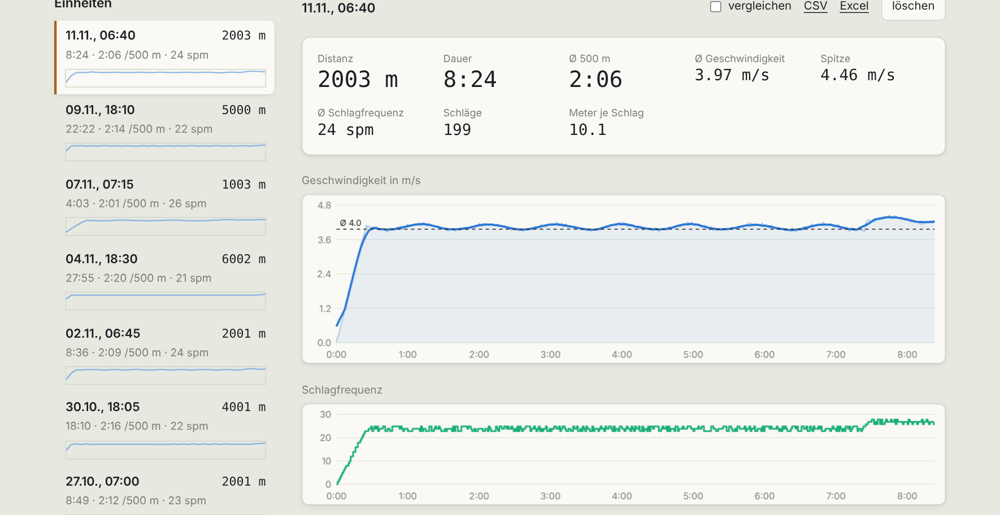
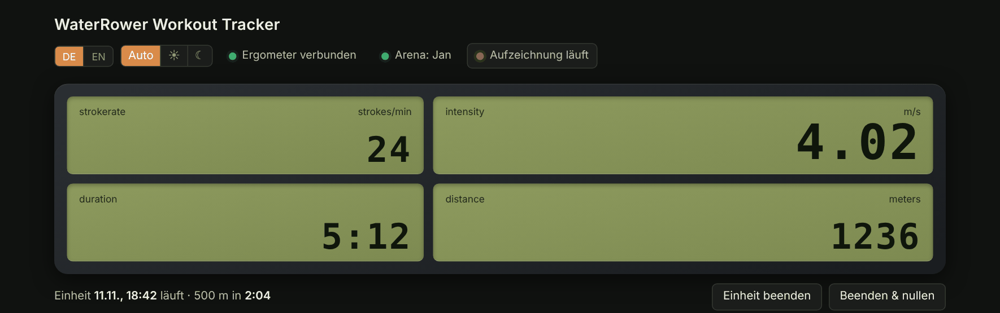
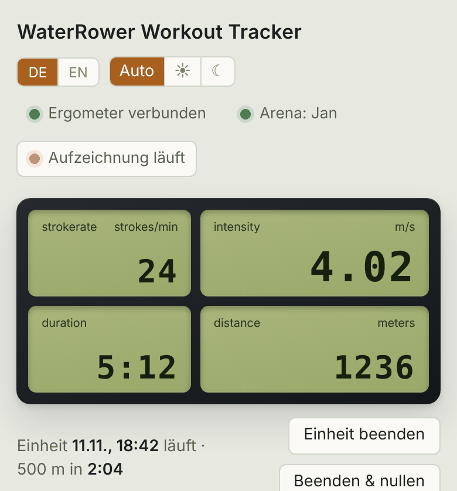
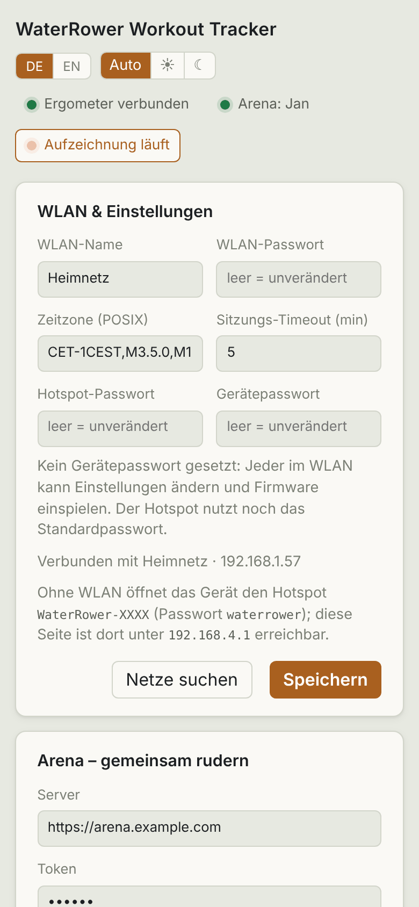

# Usage

[🇩🇪 Deutsch](../docs_de/bedienung.md) · 🇬🇧 English

## Live

While rowing, the page shows distance, pace, split per 500 m, stroke rate, watts and duration, plus a history chart. Values arrive via server-sent events from the ESP, once per second. A workout starts with the first stroke and ends after the configured timeout or via *End session*. *Reset* discards the running workout.

The chips at the top show whether the S4 is connected, whether recording is running and whether the arena is connected.

## History and comparison

Each workout appears with date, distance, duration, average pace and a sparkline. Click one to open it with charts. *Compare* overlays several workouts.

## Export

- **CSV** per workout
- **Excel** per workout or for all, generated in the browser (no chart)

## Phone and dark mode

Toggles at the top for language (DE/EN) and theme (auto, light, dark).

## Storage

Workouts live in internal flash (~10 MB). When space gets tight the oldest are deleted. After a power loss the running workout is restored on the next start.

> All screenshots show generated sample data.
