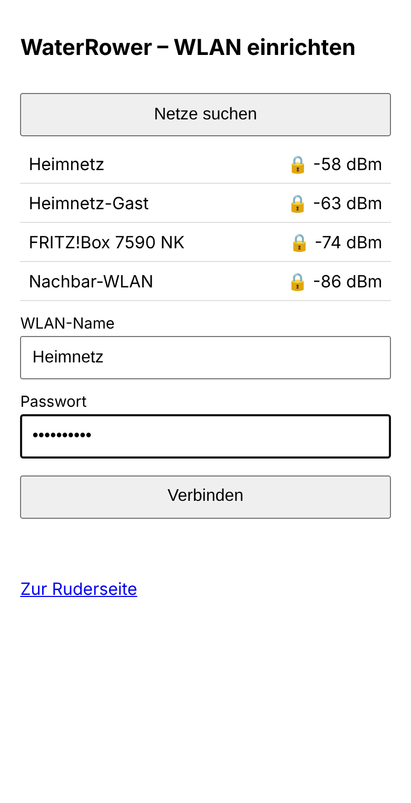
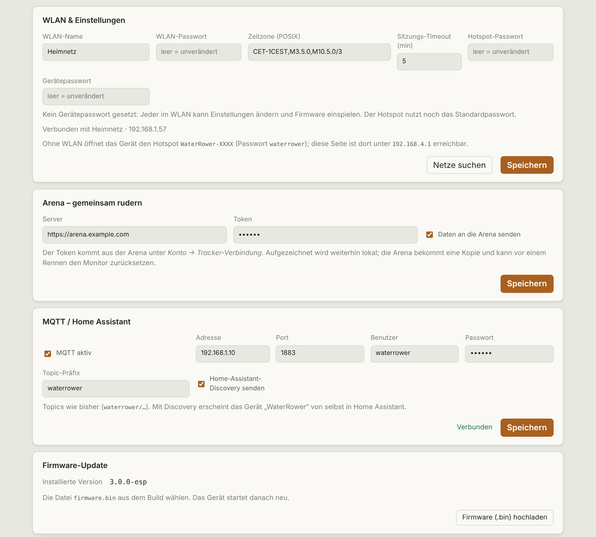

# Setup

[🇩🇪 Deutsch](../docs_de/einrichtung.md) · 🇬🇧 English

## Hardware

- ESP32-S3-DevKitC-1 (N16R8: 16 MB flash, 8 MB PSRAM)
- USB-OTG solder bridge on the board closed
- **COM** port to the PC (flashing, log), **USB** port via adapter to the WaterRower S4 (host mode)
- Case: [case/](../case/)

## Flashing

### Prebuilt image

[`firmware/release/waterrower-esp-3.0.0-merged.bin`](../firmware/release/) contains bootloader, partition table, OTA data and app and goes to **address 0x0**:

- Browser (Chrome/Edge): <https://espressif.github.io/esptool-js/>, offset `0x0`
- Command line: `esptool --chip esp32s3 write_flash 0x0 waterrower-esp-3.0.0-merged.bin`

Checksum in `SHA256SUMS`. The image is a build of the respective commit, not a signed release.

### Build it yourself

```bash
pip install platformio
cd firmware
pio run                 # builds .pio/build/esp32s3/firmware.bin
pio run -t upload       # first flash via COM (hold BOOT if needed)
pio device monitor      # log
```

Later updates go through the web UI (*Firmware update* card, file `firmware.bin`).

## Wi-Fi setup

Without stored credentials, or when the network is unreachable, the ESP opens the hotspot **`WaterRower-XXXX`** (password `waterrower`) after about 20 s.



1. Connect your phone to the hotspot. The setup page opens by itself, otherwise go to `http://192.168.4.1/setup`.
2. Pick the network, enter the password, save.
3. The ESP connects and is then reachable at `http://waterrower.local` (or its IP).

You can row without Wi-Fi too: the page is available at `192.168.4.1` on the hotspot, and the time is taken from the browser.

## Settings



| Field | Meaning |
|---|---|
| Wi-Fi name / password | Home network; an empty password keeps the stored one |
| Time zone | POSIX string, default `CET-1CEST,M3.5.0,M10.5.0/3` |
| Session timeout | Minutes without a stroke until a workout ends automatically (1–60) |
| Hotspot password | replaces `waterrower`, see [Security](sicherheit.md) |
| Device password | protects changing requests, see [Security](sicherheit.md) |

## Moving house

New Wi-Fi: just plug the ESP in. If it cannot find the old network it opens the hotspot after about 20 s; enter the new Wi-Fi there.

## Clock

NTP as soon as internet is available. Otherwise the ESP takes the time from the browser that opens the page.
