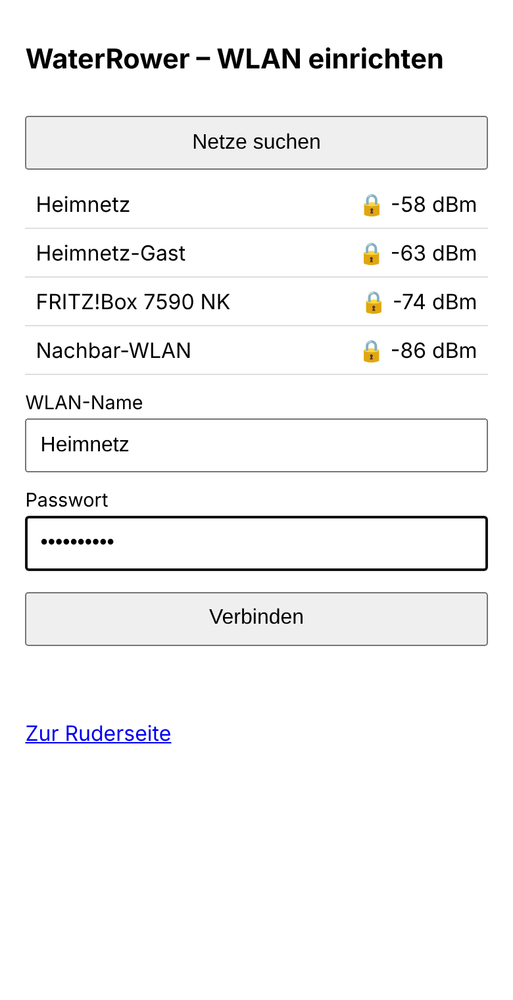
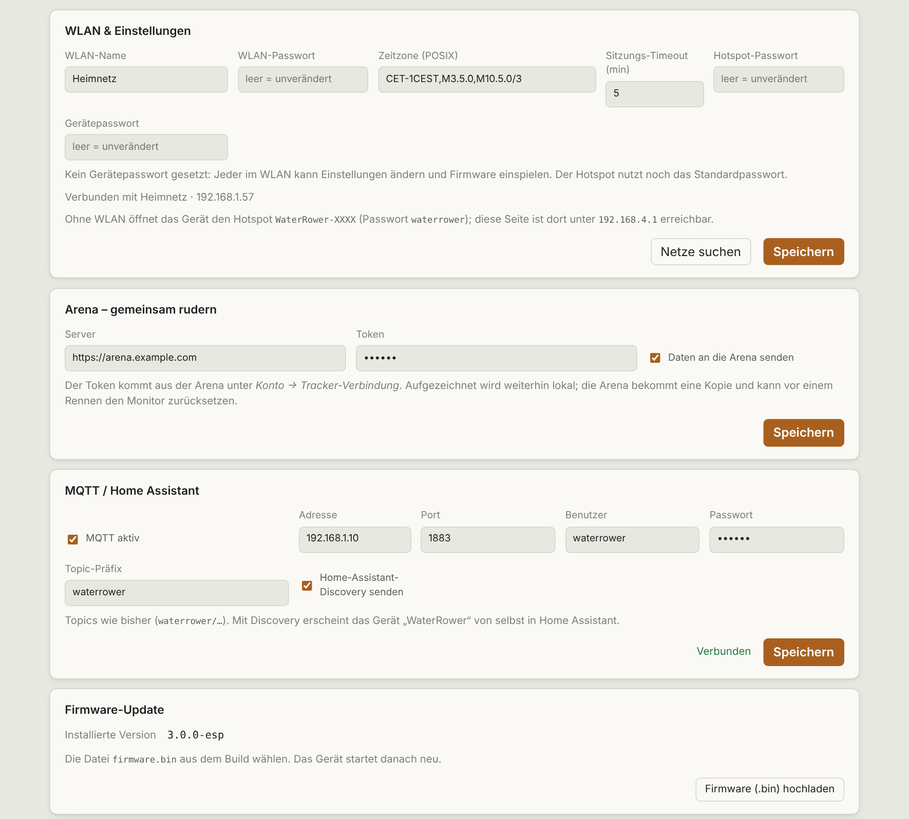

# Setup

[🇩🇪 Deutsch](../docs_de/einrichtung.md) · 🇬🇧 English

From a bare board to your first workout. No prior knowledge needed.

## Overview

1. [Get and connect the hardware](#hardware)
2. [Flash the firmware](flashing.md) (once, on a computer)
3. [Set up Wi-Fi](#wi-fi-setup) (on your phone)
4. [Open the page and row](#open-the-page)

## Hardware

- **ESP32-S3-DevKitC-1, variant N16R8** (16 MB flash, 8 MB PSRAM). Other variants have too little memory.
- A USB-C **data cable** for flashing.
- A **USB-C power supply** (5 V) for permanent use.
- A connection from the ESP's **USB** port to the WaterRower S4's Mini-USB socket. The ESP acts as USB host there. A USB OTG adapter (USB-C plug to USB-A socket) plus a normal USB-A to Mini-USB cable is the usual way. *This cabling has not been tested on real hardware yet.*
- The small **USB-OTG solder bridge** on the board must be closed (labelled "USB-OTG" near the USB socket).
- Optionally a [printable case](../case/).

The board's two sockets: **COM** (for flashing and power) and **USB** (to the S4). Do not mix them up.

## Flashing

In detail with step-by-step instructions and troubleshooting: **[Flashing with the browser flasher](flashing.md)**. In short: write [`firmware/release/waterrower-esp-3.0.0-merged.bin`](../firmware/release/) to address **`0x0`**.

To build it yourself: [Development](development.md).

## Wi-Fi setup

Without stored credentials the ESP opens the hotspot **`WaterRower-XXXX`** (password `waterrower`) immediately. If it knows a network that is unreachable, it does so after about 20 seconds.

1. On your phone, open the Wi-Fi settings and join **`WaterRower-XXXX`**, password `waterrower`. The phone warns "no internet": **stay connected**. Briefly turn off mobile data if the phone keeps switching back.
2. The setup page opens by itself. Otherwise enter `http://192.168.4.1/setup` in the browser.
3. **Scan networks**, tap your network, enter the password, **Connect**.
4. The ESP connects and the hotspot disappears. Reconnect your phone to your home Wi-Fi.

## Open the page

On the home Wi-Fi enter **`http://waterrower.local`** in the browser (`http://`, not `https://`).

If nothing opens (some Android devices do not know `.local`): find **"waterrower"** in your router's device list and enter its IP address, e.g. `http://192.168.1.57`. Another name such as `waterrower.fritz.box` is refused for security reasons; use the IP then.

It works without Wi-Fi too: join the hotspot and open `http://192.168.4.1`.

The chip at the top shows **"Ergometer connected"** as soon as the S4 is attached to the ESP. The first stroke starts a workout. Everything else: [Usage](usage.md).

## Settings

Card **WiFi & settings** (further down the page):

| Field | Meaning |
|---|---|
| WiFi name / password | Home network; an empty password field keeps the stored one. *Scan networks* lists networks in range. |
| Time zone | POSIX string, default `CET-1CEST,M3.5.0,M10.5.0/3` (Central Europe with daylight saving) |
| Session timeout | Minutes without a stroke until a workout ends automatically (1–60, default 5) |
| Hotspot password | replaces `waterrower` (at least 8 characters), see [Security](security.md) |
| Device password | protects changes, see [Security](security.md) |

Below: cards for [Arena](arena.md), [MQTT / Home Assistant](mqtt-home-assistant.md) and *Firmware update*. The screenshots show the German UI; the DE/EN toggle at the top switches it.

## Moving house or new Wi-Fi

Plug the ESP in. If it cannot find the old network it opens the hotspot after about 20 s; enter the new Wi-Fi there.

## Clock

Via NTP as soon as internet is available. Otherwise the ESP takes the time from the browser that opens the page.

## Help

| Problem | Fix |
|---|---|
| Hotspot does not appear | Wait 30 s, unplug and replug the ESP. Further: [Flashing, troubleshooting](flashing.md#if-something-goes-wrong) |
| Setup page does not open | Enter `http://192.168.4.1/setup` by hand, turn mobile data off |
| Page does not load on the home Wi-Fi | Use the IP instead of `waterrower.local` |
| "Ergometer connected" does not appear | Check cable and OTG adapter and switch the S4 monitor on |
| Forgot the device password | Reflash with *Erase Flash* ([Flashing](flashing.md)); settings and workouts are lost |
