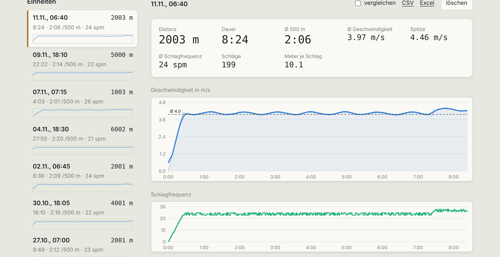
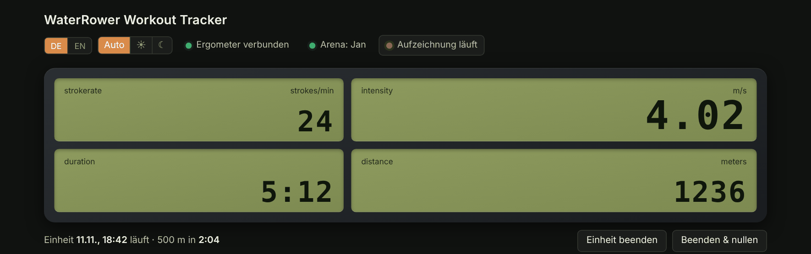
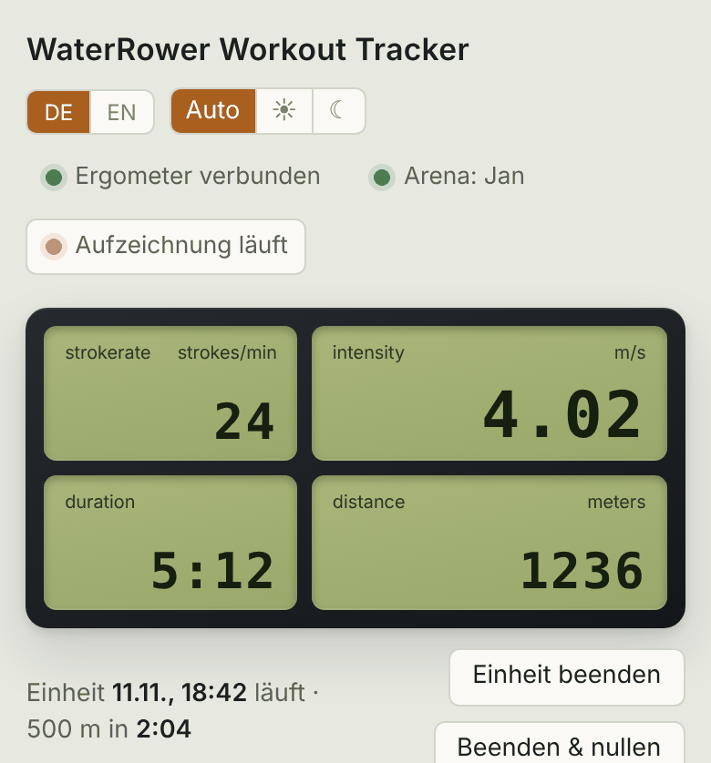
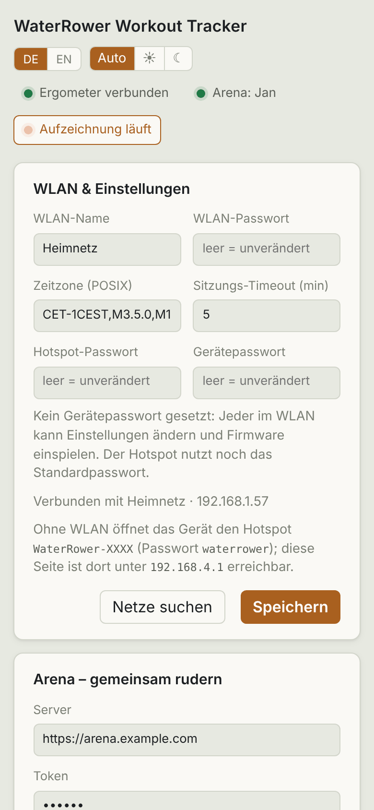

# Usage

[🇩🇪 Deutsch](../docs_de/bedienung.md) · 🇬🇧 English

Open the page in a browser at `http://waterrower.local` (phone or PC on the same Wi-Fi, see [Setup](setup.md#open-the-page)). The screenshots show the German UI; the DE/EN toggle at the top switches it.

## Live

Four tiles like on the monitor: **stroke rate** (strokes/min), **speed** (m/s), **duration** and **distance** (m). Below them the running workout with the time for 500 m. Until the first stroke it says "Waiting for a stroke".

The chips at the top: **Ergometer connected** (S4 detected on the ESP), **recording** and **Arena: name** (if the [arena](arena.md) is connected). Values arrive once per second directly from the ESP.

A workout starts with the first stroke and ends after the configured timeout (default 5 minutes without a stroke) or with a button:

- **End session:** finishes the workout; the monitor keeps its display.
- **End & zero:** finishes it and sets the monitor back to zero.

## Sessions and history

On the left the list of all workouts: date, distance, duration, time per 500 m, stroke rate and a small speed sparkline. Clicking one opens it on the right with key figures (distance, duration, avg 500 m, avg speed, peak, avg stroke rate, strokes, metres per stroke) and two charts: speed and stroke rate over time.

**Compare:** tick *compare* on up to four workouts and a chart at the bottom overlays their speed from the start. *All sessions* shows distance per workout over time.

## Export and delete

- **CSV** and **Excel** per workout (links above the workout), **All as Excel** for all workouts. Excel is generated in the browser and contains tables, no chart.
- **delete** removes a workout permanently (with confirmation).

## Phone and dark mode

At the top left you switch language (DE/EN) and appearance (auto, light, dark). The page is made for phones.

## Storage

Workouts live in the ESP's internal flash (about 10 MB). When space gets tight the oldest are deleted. After a power loss the running workout is restored on the next start. To keep workouts permanently, export them as CSV or Excel.

> All screenshots show generated sample data.
